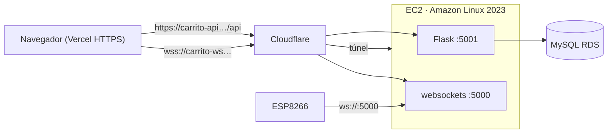

# Despliegue e Infraestructura — Carrito IoT Backend

Documento técnico: **cómo funciona, dónde corre, cómo se instala, cómo se prueba y cómo se
monitorea** el backend del Carrito IoT.
Para el resumen orientado a portafolio, ver [`README.md`](README.md).

> **Nota de seguridad:** este archivo usa **placeholders** (`<ELASTIC_IP>`, `<RDS_ENDPOINT>`,
> `<VPC_ID>`, …) a propósito: los endpoints/IPs/IDs reales **no** puedo versionarlos.

---

## 1. Qué es

Backend del carrito robot, compuesto por **dos servidores en un solo proceso**:

| Servicio | Puerto | Tecnología | Rol |
|---|---|---|---|
| **REST API** | 5001 | Flask + flask-cors | CRUD/polling del panel web (movimientos, velocidad, demos) |
| **WebSocket** | 5000 | librería `websockets` | Empuja los comandos en tiempo real al ESP8266 y al navegador |
| **Base de datos** | 3306 | MySQL (AWS Aurora RDS) | Historial, catálogos y stored procedures |

Se ejecuta como servicio **systemd** (`carrito-api`) en una instancia **EC2** de Linux Debian.

---

## 2. Dónde corre (la instancia)

| Dato | Valor |
|---|---|
| Proveedor / región | **AWS EC2** · `us-east-1` |
| Sistema operativo | **Amazon Linux 2023** |
| Usuario | `ec2-user` |
| Acceso | SSH (puerto 22) |
| IP pública | **Elastic IP** `<ELASTIC_IP>` (fija, sobrevive reinicios) |
| **IPv6** | **Habilitado** (`<IPv6_PUBLICA>`); el Security Group abre `::/0` |
| IP privada | `<10.x.x.x>` (dentro de la VPC) |
| Ruta del proyecto | `/home/ec2-user/Carrito_backend/TestingAPIWebsockets/WebSockets` |
| Python | **3.11** (venv propio) |
| Servicio | `carrito-api.service` (systemd) |

---

## 3. IPv6 (observación, hipótesis sin confirmar)

- **Observación:** con el **hotspot de un iPhone** el ESP8266 **no conectaba**; con el
  **Wi-Fi de casa sí**.
- **Hipótesis (no confirmada):** la red del hotspot era **IPv6-first**, mientras que el
  firmware del ESP usa una **IP IPv4**.
- **Decisión:** se conserva **IPv6** en la instancia y las reglas `::/0` del Security Group
  para no descartar clientes IPv6. Esto **no** garantiza por sí solo la conexión del ESP
  (que usa IPv4).

**Recomendación:** no deshabilitar IPv6 en la instancia ni borrar las reglas `::/0` del Security Group.

---

## 4. AWS: VPC, subredes, Security Group y RDS

- **VPC / subredes:** la EC2 vive en una VPC (`<VPC_ID>`) con subredes (`<SUBNET_ID>`,
  p. ej. `10.20.x.x`). RDS debe estar **accesible desde la subred de la EC2**.
- **Security Group (EC2)** — reglas de entrada relevantes:
  | Puerto | Protocolo | Origen | Para qué |
  |---|---|---|---|
  | 22 | TCP | tu IP | SSH |
  | **5000** | TCP | `0.0.0.0/0` (+`::/0`) | WebSocket crudo del ESP8266 |
  | 5001 | TCP | `0.0.0.0/0` (+`::/0`) | REST (aunque para el navegador se usa el túnel) |
  | — | ICMPv6 | `::/0` | diagnóstico IPv6 |
- **RDS (MySQL 8.4)** — endpoint `<RDS_ENDPOINT>`, base `carrito_iot`.
  - Debe permitir el **Security Group de la EC2** en el puerto **3306**.
  - Credenciales SOLO en el `.env` de la EC2 (nunca en el repo).

---

## 5. Instalación (desde cero)

Script monolítico incluido: [`setup_ec2.sh`](setup_ec2.sh). Resumen de lo que hace:

```bash
sudo dnf update -y
sudo dnf install -y git python3.11 python3.11-pip          # AL2023 trae python 3.9; los pins piden >=3.10
git clone -b main https://github.com/Villa19d/Iot_carrito_aws_backend.git /home/ec2-user/Carrito_backend
cd /home/ec2-user/Carrito_backend/TestingAPIWebsockets/WebSockets
python3.11 -m venv venv && source venv/bin/activate
pip install -r requirements.txt                             # (se normaliza de UTF-16 -> UTF-8 si hace falta)
cp ../../.env.example .env                                  # y se rellena con los datos reales
# crea y arranca el servicio systemd carrito-api (ver §6)
```

> El `requirements.txt` **ya incluye** `websockets`, `Flask`, `flask-cors` y
> `mysql-connector-python`, así que no hay dependencias extra.

---

## 6. Variables de entorno (`.env`)

Archivo `/home/ec2-user/Carrito_backend/TestingAPIWebsockets/WebSockets/.env`
(se carga con `EnvironmentFile=` de systemd; **nunca** se sube al repo):

```ini
DB_HOST=<RDS_ENDPOINT>
DB_USER=<usuario>
DB_PASSWORD=<password>
DB_NAME=carrito_iot
DB_PORT=3306
WS_HOST=0.0.0.0
WS_PORT=5000
PUBLIC_IP=<ELASTIC_IP>
```

⚠️ Consideración importante: **el `.env` debe estar en LF y sin comillas/espacios**.
Si tiene **CRLF**, la contraseña llega con un `\r` y MySQL devuelve **1045 Access denied**.

### Servicio systemd `/etc/systemd/system/carrito-api.service`
```ini
[Service]
User=ec2-user
WorkingDirectory=/home/ec2-user/Carrito_backend/TestingAPIWebsockets/WebSockets
EnvironmentFile=-/home/ec2-user/Carrito_backend/TestingAPIWebsockets/WebSockets/.env
ExecStart=/home/ec2-user/Carrito_backend/TestingAPIWebsockets/WebSockets/venv/bin/python \
          /home/ec2-user/Carrito_backend/TestingAPIWebsockets/WebSockets/server_final.py
Restart=on-failure
```

---

## 7. Cloudflare Tunnel (HTTPS/WSS gratis, sin abrir puertos al navegador)

El túnel se **administra desde el dashboard** de Cloudflare (Zero Trust → Networks → Tunnels),
y la EC2 solo recibe un **token** (no hay `config.yml` local). Rutas públicas:

| Hostname | Servicio (origen) |
|---|---|
| `carrito-api.rodrigodvillar.com` | `http://127.0.0.1:5001` (REST) |
| `carrito-ws.rodrigodvillar.com`  | `http://127.0.0.1:5000` (WebSocket) |

```bash
sudo dnf install -y https://github.com/cloudflare/cloudflared/releases/latest/download/cloudflared-linux-x86_64.rpm
sudo cloudflared service install <TOKEN_DEL_DASHBOARD>   # pega tu token real (es un secreto)
sudo systemctl status cloudflared --no-pager
```
Cloudflare termina **HTTP** y **WS** en su edge; hacia la EC2 el tráfico va por el túnel
(saliente por 443). **El navegador nunca toca la IP de la EC2.**

> ⚠️ Para que el WebSocket funcione por el túnel, el servidor de origen debe ser un
> **servidor WebSocket estándar** (se migró de un socket crudo a la librería `websockets`).

### Flujo completo


---

## 8. Comandos de testeo

```bash
# --- LOCAL (en la EC2) ---
curl -s http://127.0.0.1:5001/api/movimientos            # 11 movimientos (no toca BD)

# --- POR EL TÚNEL / DOMINIO ---
curl -s https://carrito-api.rodrigodvillar.com/api/demos # JSON con las demos (usa BD)
npx wscat -c wss://carrito-ws.rodrigodvillar.com         # debe decir "Connected"

# --- Enviar un movimiento (verás el frame llegar en wscat) ---
curl -s -X POST http://127.0.0.1:5001/api/enviar_movimiento \
  -H "Content-Type: application/json" \
  -d '{"movimiento":"Adelante","identificador":"ESP8266-CAR-001"}'

# --- Probar la BD directamente ---
cd /home/ec2-user/Carrito_backend/TestingAPIWebsockets/WebSockets
source venv/bin/activate && set -a; source .env; set +a
python -c "import os,mysql.connector;c=mysql.connector.connect(host=os.environ['DB_HOST'],user=os.environ['DB_USER'],password=os.environ['DB_PASSWORD'],database='carrito_iot');print('DB OK');c.close()"
```
> En **PowerShell**, usa `Invoke-RestMethod` (comillas simples) — `curl.exe` destroza el JSON.

---

## 9. Comandos de monitoreo

```bash
sudo systemctl status carrito-api            # ¿está corriendo?
sudo systemctl restart carrito-api           # aplicar cambios del .env
sudo journalctl -u carrito-api -f            # LOGS EN VIVO (conexiones WS, envíos, errores)
sudo journalctl -u carrito-api -n 40 --no-pager
sudo ss -tlnp | grep -E ':5000|:5001'        # ¿los puertos escuchan?
sudo systemctl status cloudflared            # estado del túnel
sudo journalctl -u cloudflared -n 30 --no-pager
```

---

## 10. Tecnologías usadas

| Capa | Tecnología |
|---|---|
| Lenguaje | **Python 3.11** |
| Web/REST | **Flask**, flask-cors |
| WebSocket | librería **`websockets`** (servidor estándar) + `asyncio` |
| Base de datos | **MySQL 8.4** en **Amazon RDS**, `mysql-connector-python` |
| Proceso | **systemd** (`carrito-api.service`) |
| Infra | **AWS EC2** (Amazon Linux 2023), **VPC/subredes**, Security Groups, **Elastic IP**, **IPv6** |
| Exposición | **Cloudflare Tunnel** + DNS + dominio propio |
| Hardware | **ESP8266** + puente H (L9110S) + sensor ultrasónico HC-SR04 |

---

## 11. Solución de problemas (historial real de este proyecto)

| Síntoma | Causa | Solución |
|---|---|---|
| `pip: No matching distribution` | AL2023 trae **Python 3.9** y los pins piden ≥3.10 | usar **`python3.11`** para el venv |
| `requirements.txt` no instala | archivo en **UTF‑16** | convertir a UTF‑8 antes de `pip install` |
| El servicio no arrancaba | `DB_PORT` vacío → `int('')` | rellenar el `.env` |
| **1045 Access denied** | `.env` en **CRLF** → la contraseña lleva `\r` | `sed -i 's/\r$//' .env` |
| **502 en el WebSocket** por el túnel | servidor WS **crudo** (handshake a mano) | migrar a la librería **`websockets`** |
| 502 persistía | **no se había hecho `push`/`pull`** del código nuevo | `git pull` + `restart` |
| El ESP no conecta por **hotspot** | red **IPv6-only** del operador | usar red con IPv4 / mantener **IPv6** |
| SQL: FK `detalle_secuencia_demo` | orden del dump (hijo antes que padre) | `SET FOREIGN_KEY_CHECKS=0` |

---


