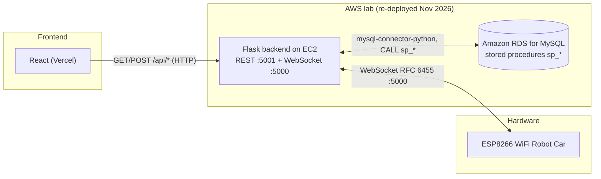

# Carrito IoT — Backend

Control and telemetry backend for an ESP8266 WiFi robot car. It exposes a **REST
API** (Flask, port `5001`) for the web panel and a **native WebSocket server**
(port `5000`) that delivers real-time movement commands to the car. Data lives in
**MySQL** and is accessed exclusively through **stored procedures**.

> **Status (Nov 2026):** this backend was **re-deployed in November 2026** on an
> **AWS lab** (EC2 + **Amazon RDS for MySQL**) — the original exam delivery was
> `01/06/2026`. The live infrastructure is expected to stay up until
> **[CONFIRMAR fecha]**; after that the frontend falls back to its in-browser
> **demo mode**. All credentials/hosts are read from environment variables
> (never committed).

---

## Architecture



### Layout

```
TestingAPIWebsockets/WebSockets/
  server_final.py        # main entry point: Flask REST (:5001) + WebSocket (:5000)
  config.py              # env-var based configuration
  model/database.py      # MySQL connector helper (singleton) + call_procedure()
  model/movimiento.py    # movements/obstacles model (stored-procedure calls)
  controller/            # movement + status controllers
  app.py                 # legacy minimal WebSocket-only server
  websocket/socket_server.py   # legacy native WebSocket server (action-based messages)
SQL_Scripts/01_carrito_iot_schema_seed_sp.sql  # full DB bootstrap: CREATE DATABASE +
                                               # 11 tables + seed data + 14 stored procedures
                                               # (incl. the ESP8266 fix sp_ultimo_movimiento_esp)
```

---

## REST endpoints

The web panel consumes the following API (all under `/api`):

| Method | Path | Description | Success payload |
|--------|------|-------------|-----------------|
| GET | `/api/movimientos` | Catalogue of the 11 movements | `{ success, data: [{ id_movimiento, nombre_movimiento }] }` |
| GET | `/api/ultimo_movimiento` | Last registered movement (+ PWM/timing) | `{ success, data: { nombre_movimiento, mia_pwm, mda_pwm, mi_time, fecha_hora } }` |
| GET | `/api/velocidad` | Current global speed (0–255) | `{ success, velocidad }` |
| POST | `/api/velocidad` | Set global speed | `{ success, velocidad }` |
| POST | `/api/enviar_movimiento` | Send a movement to the car and store it | `{ success, message }` |
| GET | `/api/demos` | List DEMO sequences | `{ success, data: [{ id_secuencia, nombre_secuencia, total_movimientos }] }` |
| POST | `/api/ejecutar_demo` | Run a DEMO sequence | `{ success, message }` |

Request bodies:

```json
// POST /api/enviar_movimiento
{ "movimiento": "Adelante", "identificador": "ESP8266-CAR-001" }

// POST /api/velocidad
{ "velocidad": 200 }

// POST /api/ejecutar_demo
{ "demo_id": 1, "demo_nombre": "Zig Zag", "identificador": "ESP8266-CAR-001" }
```

**Speed rule:** turning movements (ids 8–11) ignore the global speed; straight /
curved movements scale their PWM by `velocidad / 255`. DEMO playback injects an
explicit `Detener` after each step to cancel the car's inertia.

---

## WebSocket protocol

- **Endpoint:** `ws://<host>:5000` — implemented with the standard **`websockets`**
  library (`server_final.py`). A standard handshake is required so the
  **Cloudflare Tunnel** can proxy **WSS** to browsers (the earlier hand-rolled
  server produced `502`).
- **Direction:** server → device (and server → web panel for realtime updates).
- **Frame payload (JSON):**

```json
{
  "success": true,
  "data": {
    "movimiento": "Adelante",
    "mia_pwm": 255,
    "mda_pwm": 255,
    "mi_time": 500
  }
}
```

`mia_pwm`/`mda_pwm` are the PWM of the left/right motors and `mi_time` is the
duration in milliseconds the car should drive before stopping.

Legacy note: an earlier version (`TestingAPIWebsockets/WebSockets/socket_server.py`)
used request/response action messages (`get_ultimo_movimiento`,
`agregar_movimiento`, `agregar_obstaculo`, …). `server_final.py` is the version
the frontend and the demo used.

---

## Database & stored procedures

The complete database (schema + seed data + stored procedures) is in
`SQL_Scripts/01_carrito_iot_schema_seed_sp.sql`. Tables:
`cat_movimientos`, `config_motor_movimiento`, `secuencias_demo`,
`detalle_secuencia_demo`, `movimientos_registrados`, `dispositivos`,
`obstaculos_registrados`, `cat_estatus_obstaculo`, `telemetria_dispositivo`,
`parametros`, `ejecuciones_secuencia_demo`.

| Stored procedure | Purpose |
|------------------|---------|
| `sp_ultimo_movimiento` | Full data of the last registered movement |
| `sp_ultimo_movimiento_esp` | Simplified movement (PWM + time) for the ESP8266 |
| `sp_ultimos_10_movimientos` | Last 10 movements |
| `sp_agregar_movimiento` | Register a movement for a device |
| `sp_agregar_movimiento_por_id` | Register a movement by movement id |
| `sp_actualizar_parametro` | Update a value in `parametros` (e.g. speed) |
| `sp_agregar_obstaculo` / `sp_ultimo_obstaculo` / `sp_ultimos_10_obstaculos` | Obstacle logging/queries |
| `sp_crear_demo` | Create a DEMO sequence |
| `sp_agregar_movimiento_a_demo` | Append a movement to a sequence |
| `sp_repetir_demo` | Replay a DEMO sequence |
| `sp_visualizar_demo` | List the ordered steps of a sequence |
| `sp_generar_configuracion_motores` | Regenerate per-movement motor configuration |

---

## Running it

Requirements: Python 3 and the packages in `requirements.txt`
(Flask, flask-cors, mysql-connector-python, websocket-client, …).

```bash
pip install -r TestingAPIWebsockets/WebSockets/requirements.txt
```

Configure the environment (copy `.env.example` to `.env` and fill it in):

```bash
DB_HOST=...
DB_USER=...
DB_PASSWORD=...
DB_NAME=carrito_iot
DB_PORT=3306
WS_HOST=0.0.0.0
WS_PORT=5000
PUBLIC_IP=...
```

Then start the server:

```bash
cd TestingAPIWebsockets/WebSockets
python server_final.py
# REST  -> http://0.0.0.0:5001
# WS    -> ws://0.0.0.0:5000
```

---

## Firmware

The **ESP8266 WebSocket client** lives in
[`firmware/esp8266_ws_client/`](firmware/esp8266_ws_client) (main sketch:
`esp8266_ws_client.ino`). It uses `WebSocketsClient` to connect to
`ws://<ELASTIC_IP>:5000`, parses the JSON command (`movimiento`, `mia_pwm`,
`mda_pwm`, `mi_time`) and drives the motors.

Wi-Fi credentials and the WebSocket host are **not** hard-coded in the sketch:
they are read from `secrets.h`, which is **gitignored**. Copy the template and
fill it in:

```bash
cd firmware/esp8266_ws_client
cp secrets.example.h secrets.h     # then edit WIFI_SSID / WIFI_PASSWORD / WS_HOST
```

---

## Infrastructure (summary)

> 📄 Full technical document: **[`DEPLOYMENT.md`](DEPLOYMENT.md)**

| Component | Detail |
|---|---|
| **Compute** | AWS **EC2** (Amazon Linux 2023) with **Elastic IP** and **IPv6** enabled |
| **Service** | `carrito-api` (systemd) → Flask **:5001** + WebSocket **:5000** |
| **Database** | **Amazon RDS for MySQL** (database `carrito_iot`) |
| **Exposure** | **Cloudflare Tunnel** → `carrito-api.rodrigodvillar.com` (REST) and `carrito-ws.rodrigodvillar.com` (WSS) |
| **Network** | AWS VPC and subnets + Security Group (22, 5000, 5001, ICMPv6) |

**IPv6 (observation, unconfirmed hypothesis):** the ESP8266 **did not connect** over an
**iPhone hotspot** but **did over the home Wi-Fi**. **Hypothesis (unconfirmed):** the hotspot
was **IPv6-first** while the firmware uses an **IPv4** address. IPv6 is kept on the instance and
`::/0` rules in the Security Group, but this alone does **not** guarantee the ESP connection
(which uses IPv4).

### How it connects
```
ESP8266   ── ws://<ELASTIC_IP>:5000 ─────────────────► EC2 :5000  (websockets server)
Browser   ── wss://carrito-ws.rodrigodvillar.com ────► Cloudflare Tunnel ► EC2 :5000
Browser   ── https://carrito-api.rodrigodvillar.com/api ► Cloudflare Tunnel ► EC2 :5001 (Flask)
                                                          Flask ► MySQL (Amazon RDS)
```

### Quick commands
```bash
sudo systemctl status carrito-api            # is it running?
sudo journalctl -u carrito-api -f            # live logs
curl -s https://carrito-api.rodrigodvillar.com/api/movimientos
```

---

## ⚠️ Limitations (demo, not production)

- **No authentication:** the API validates no users/tokens; anyone with the URL could send
  commands to the car.
- **Exposed ports:** the Security Group opens **5000/5001**. Recommended: **close 5001** (the
  browser uses the Cloudflare Tunnel) and keep **5000** only for the ESP8266.
- **Not production-ready:** Flask dev server + `websockets`, no native TLS (provided by
  Cloudflare Tunnel).
- **Firmware:** continuous movements (**Adelante / Atrás**) are **not stopped by the firmware if
  the WebSocket connection is lost** — a client-side safety timeout would be required.
- The physical car stays **disconnected** except while recording.

