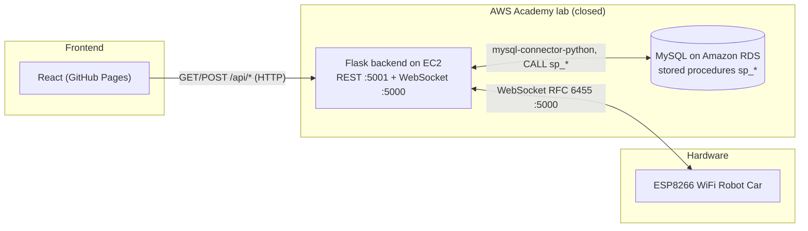

# Carrito IoT — Backend

Control and telemetry backend for an ESP8266 WiFi robot car. It exposes a **REST
API** (Flask, port `5001`) for the web panel and a **native WebSocket server**
(port `5000`) that delivers real-time movement commands to the car. Data lives in
**MySQL** and is accessed exclusively through **stored procedures**.

> **Honest status:** this backend originally ran on a temporary **AWS Academy**
> lab (EC2 + RDS). That lab is **closed**, so the live deployment no longer
> exists. The code and schema are kept as a reference and to be re-hosted. All
> credentials/hosts have been replaced by environment variables.

---

## Architecture (original AWS deployment)



### Layout

```
TestingAPIWebsockets/WebSockets/
  server_final.py        # main entry point: Flask REST (:5001) + WebSocket (:5000)
  config.py              # env-var based configuration
  model/database.py      # MySQL connector helper (singleton) + call_procedure()
  model/movimiento.py    # movements/obstacles model (stored-procedure calls)
  controller/            # movement + status controllers
  app.py                 # legacy minimal WebSocket-only server
  socket_server.py       # legacy native WebSocket server (action-based messages)
SQL_Scripts/esquema_bd_y_sp.sql   # schema + stored procedures (no seed data)
```

---

## REST endpoints

The web panel consumes the following API (all under `/api`):

| Method | Path | Description | Success payload |
|--------|------|-------------|-----------------|
| GET | `/api/movimientos` | Catalogue of the 11 movements | `{ success, data: [{ id_movimiento, nombre_movimiento }] }` |
| GET | `/api/ultimo_movimiento` | Last registered movement (+ PWM/timing) | `{ success, data: { nombre_movimiento, mia_pwm, mda_pwm, mi_time, fecha_hora } }` |
| GET | `/api/velocidad` | Current global speed (0–255) | `{ success, velocidad }` |
| POST | `/api/velocidad` | Set global speed | `{ success, velocidad }` |
| POST | `/api/enviar_movimiento` | Send a movement to the car and store it | `{ success, message }` |
| GET | `/api/demos` | List DEMO sequences | `{ success, data: [{ id_secuencia, nombre_secuencia, total_movimientos }] }` |
| POST | `/api/ejecutar_demo` | Run a DEMO sequence | `{ success, message }` |

Request bodies:

```json
// POST /api/enviar_movimiento
{ "movimiento": "Adelante", "identificador": "ESP8266-CAR-001" }

// POST /api/velocidad
{ "velocidad": 200 }

// POST /api/ejecutar_demo
{ "demo_id": 1, "demo_nombre": "Zig Zag", "identificador": "ESP8266-CAR-001" }
```

**Speed rule:** turning movements (ids 8–11) ignore the global speed; straight /
curved movements scale their PWM by `velocidad / 255`. DEMO playback injects an
explicit `Detener` after each step to cancel the car's inertia.

---

## WebSocket protocol

- **Endpoint:** `ws://<host>:5000` — a hand-rolled RFC 6455 server (manual
  handshake, no external library) implemented in `server_final.py`.
- **Direction:** server → device (and server → web panel for realtime updates).
- **Frame payload (JSON):**

```json
{
  "success": true,
  "data": {
    "movimiento": "Adelante",
    "mia_pwm": 255,
    "mda_pwm": 255,
    "mi_time": 500
  }
}
```

`mia_pwm`/`mda_pwm` are the PWM of the left/right motors and `mi_time` is the
duration in milliseconds the car should drive before stopping.

Legacy note: an earlier version (`TestingAPIWebsockets/WebSockets/socket_server.py`)
used request/response action messages (`get_ultimo_movimiento`,
`agregar_movimiento`, `agregar_obstaculo`, …). `server_final.py` is the version
the frontend and the demo used.

---

## Database & stored procedures

Schema and procedures are in `SQL_Scripts/esquema_bd_y_sp.sql`. Tables:
`cat_movimientos`, `config_motor_movimiento`, `secuencias_demo`,
`detalle_secuencia_demo`, `movimientos_registrados`, `dispositivos`,
`obstaculos_registrados`, `cat_estatus_obstaculo`, `telemetria_dispositivo`,
`parametros`, `ejecuciones_secuencia_demo`.

| Stored procedure | Purpose |
|------------------|---------|
| `sp_ultimo_movimiento` | Full data of the last registered movement |
| `sp_ultimo_movimiento_esp` | Simplified movement (PWM + time) for the ESP8266 |
| `sp_ultimos_10_movimientos` | Last 10 movements |
| `sp_agregar_movimiento` | Register a movement for a device |
| `sp_agregar_movimiento_por_id` | Register a movement by movement id |
| `sp_actualizar_parametro` | Update a value in `parametros` (e.g. speed) |
| `sp_agregar_obstaculo` / `sp_ultimo_obstaculo` / `sp_ultimos_10_obstaculos` | Obstacle logging/queries |
| `sp_crear_demo` | Create a DEMO sequence |
| `sp_agregar_movimiento_a_demo` | Append a movement to a sequence |
| `sp_repetir_demo` | Replay a DEMO sequence |
| `sp_visualizar_demo` | List the ordered steps of a sequence |
| `sp_generar_configuracion_motores` | Regenerate per-movement motor configuration |

---

## Running it

Requirements: Python 3 and the packages in `requirements.txt`
(Flask, flask-cors, mysql-connector-python, websocket-client, …).

```bash
pip install -r TestingAPIWebsockets/WebSockets/requirements.txt
```

Configure the environment (copy `.env.example` to `.env` and fill it in):

```bash
DB_HOST=...
DB_USER=...
DB_PASSWORD=...
DB_NAME=carrito_iot
DB_PORT=3306
WS_HOST=0.0.0.0
WS_PORT=5000
PUBLIC_IP=...
```

Then start the server:

```bash
cd TestingAPIWebsockets/WebSockets
python server_final.py
# REST  -> http://0.0.0.0:5001
# WS    -> ws://0.0.0.0:5000
```

---

## Firmware

`[TODO_CONTENT]` — the **ESP8266 firmware that speaks the WebSocket protocol is
not in this repository**. The `.ino` shipped in the project folder is the vendor
example (plain HTTP over a Wi-Fi access point, `ESP8266WebServer`), not the
WebSocket client used by this backend.

---

## Files that should be removed from version control

These are currently tracked but embed credentials or are local artifacts. They
were **not** deleted — remove them with `git rm --cached <file>` when convenient:

- `dump_db.py` — embeds DB credentials
- `rename_demos.py` — embeds DB credentials
- `update_demos.py` — embeds DB credentials
- `TestingAPIWebsockets/db_query.py` — embeds DB credentials
- `Instancia/Instancia Detalles AWS.txt` — instance details / credentials
- `__pycache__/*.pyc` — build artifacts
- `TestingAPIWebsockets/WebSockets/venv/**` — local virtualenv

`config.py` and `server_final.py` no longer embed credentials (they read
environment variables), so they are safe to keep. See `.gitignore` for the
patterns added to prevent re-committing these files.

